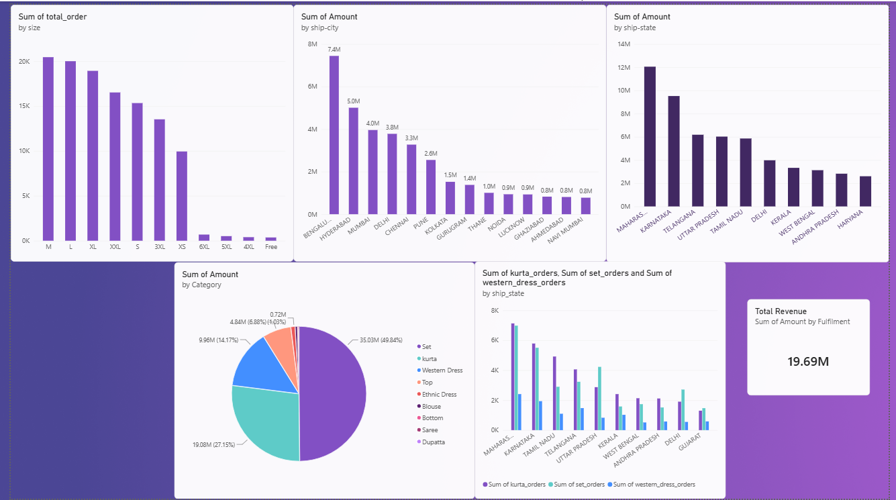

# Amazon India Apparel Sales Analysis
amazon-sales-eda/
├── README.md
├── data/
│   ├── raw/            # original dataset (if allowed to share)
│   └── cleaned/        # cleanAMAZON-sales.csv
├── notebooks/          # cleaning/exploration (Python or Excel notes)
├── dashboard/
│   ├── eda_Amazon_sales.pbix
│   └── screenshots/    # PNGs of each dashboard page
├── reports/            # optional PDF summary of insights
├── .gitignore
└── LICENSE             # optional (MIT is common)
Exploratory data analysis of Amazon India apparel orders, with an interactive Power BI dashboard showing which products, sizes and locations drive sales.

## Business Question
Which product categories, sizes, states and cities generate the most orders and revenue, and where should marketing and warehouse stock be focused?

## Dataset
- File: 'Amazon Sale Report.csv'
- File: `cleanAMAZON-sales.csv` (Cleaned data set)
- Cleaning I did: [removed duplicates, handled missing values, fixed data types, standardized city/state names]

## Tools Used
- Python (Pandas, NumPy) for data cleaning and analysis
- SQL for [For querying and grouping]
- Power BI for the dashboard

## Dashboard

The dashboard shows:
- Category vs orders
- State vs revenue
- City vs revenue
- Size vs orders
- State-wise comparison of Western Dress, Kurta and Set orders

## Key Findings
1. **Sales are concentrated in a few cities.** In Telangana and Karnataka, most of the revenue comes from one city (Hyderabad ~80%, Bengaluru ~75%). In Maharashtra, the top city Mumbai contributes only ~33%, so demand is more spread out.
2. **Set and Kurta are the most ordered categories**, with Western Dress also performing well.
3. **The most common sizes are M, L, XL, XXL and S**, which can guide stock planning.
4. **Demand varies by state.** Set orders are much lower in Tamil Nadu than in Maharashtra and Karnataka, and they are high in Uttar Pradesh.

## Recommendations
- In Karnataka and Telangana, focus marketing and warehouse stock on the top cities (Bengaluru and Hyderabad).
- In Maharashtra, target the whole state rather than only Mumbai but a focus on mumbai meropolitan area.
- Increase stock of Set, Kurta and Western Dress, and stock the common sizes first. 

## Limitations
- The dataset covers only a limited time period
- Does not mention inventory level

## Files in This Repository
- `notebooks/` : Python analysis
- `sql/` : SQL queries
- `eda_Amazon_sales.pbix` : Power BI dashboard 
- `screenshots/` : dashboard images

## What I Learned
This was my first end-to-end EDA project. I cleaned the data myself, built the dashboard, and improved it through several revisions and learned how to use ai to write various code and queries fast and even helped me to identify my mistakes and at the same time i found that even ai can make mistakes while doing analysis 

## About Me
Samuel;, BCA Analytics student at Kristu Jayanti College, Bangalore. 
LinkedIn: [https://www.linkedin.com/in/pj-samuel-4432b3358/?lipi=urn%3Ali%3Apage%3Ad_flagship3_profile_view_base_contact_details%3B6UKsODFfQJyOKzOsTZfnUw%3D%3D]
